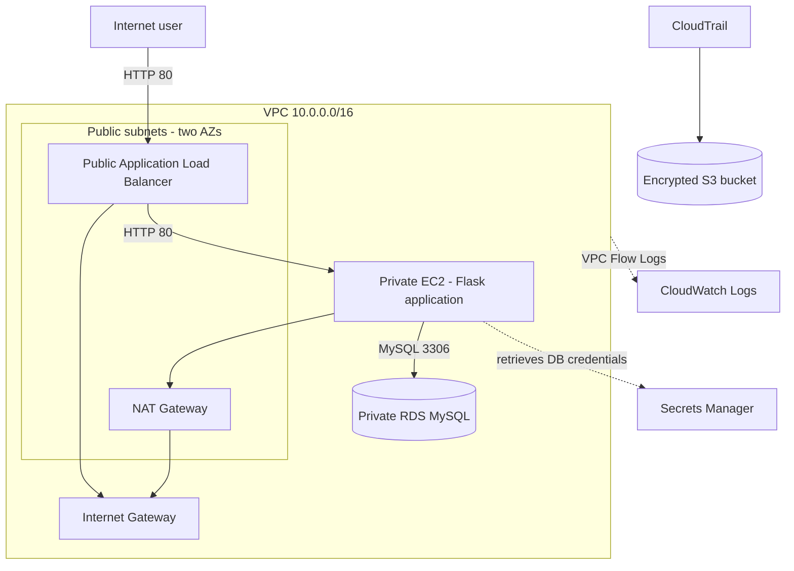

# Secure Three-Tier Application on AWS Using Terraform

## Objective
Deploy the assignment's secure three-tier architecture:
- Public web tier: internet-facing Application Load Balancer (ALB).
- Private application tier: EC2 running Flask.
- Private database tier: encrypted Amazon RDS for MySQL, not publicly accessible.
- Supporting services: VPC, public/private subnets, Internet Gateway, NAT Gateway, route tables, security groups, VPC Flow Logs, and CloudTrail.

## Architecture


## Prerequisites
1. AWS account and permissions to create VPC, EC2, ALB, RDS, IAM, CloudWatch, CloudTrail, S3, and Secrets Manager resources.
2. AWS CLI configured locally (`aws configure` or AWS IAM Identity Center).
3. Terraform CLI 1.5+ installed.
4. Use a test/non-production AWS account.

Never share AWS access keys, passwords, or secret values. Do not paste credentials into this project or commit them to Git.

## Deploy
Open a terminal in the `terraform` folder.

### 1. Confirm AWS identity
```bash
aws sts get-caller-identity
aws configure get region
```

### 2. Configure variables
```bash
cp terraform.tfvars.example terraform.tfvars
```
On Windows PowerShell:
```powershell
Copy-Item terraform.tfvars.example terraform.tfvars
```
Default region is `ap-south-1` (Mumbai). Edit values if needed. `terraform.tfvars` is ignored by Git.

### 3. Validate and preview
```bash
terraform init
terraform fmt -recursive
terraform validate
terraform plan
```
Read the plan before proceeding.

### 4. Deploy
```bash
terraform apply
```
Type `yes` only after reviewing the resources and estimated charges. It may take several minutes.

### 5. Test
Open the `application_url` output in a browser. Refresh the page. The visit counter should increase because the Flask app writes to RDS. ALB health check uses `/health`.

### 6. Verify the assignment requirements
- VPC console: public and private subnets exist across two AZs.
- ALB: internet-facing and attached to public subnets.
- EC2: in private application subnet, with no public IPv4 address.
- RDS: `Public access = No`; encrypted storage enabled.
- Database security group: inbound TCP/3306 from the application security group only.
- Application security group: inbound TCP/80 from the ALB security group only.
- ALB security group: inbound TCP/80 from the configured client CIDR.
- CloudWatch Logs: `/aws/vpc/flowlogs/secure-three-tier`.
- CloudTrail: trail enabled with encrypted S3 destination.

### 7. Collect screenshots, then destroy resources
```bash
terraform destroy
```
Review the destroy plan and type `yes`. These resources can incur ongoing charges while they exist.

## Required submission screenshots
1. Terraform apply output and `application_url`.
2. VPC resource map showing subnet tiers.
3. ALB details and healthy target.
4. EC2 details showing private subnet and no public IP.
5. RDS details showing Public access = No.
6. RDS security group showing TCP/3306 source is the app security group.
7. EC2 security group showing TCP/80 source is the ALB security group.
8. Browser showing the app and database-backed visit count.
9. CloudWatch Flow Logs log group.
10. CloudTrail trail and S3 destination.

## Limitations / security notes
- HTTP/80 is used to simplify the college demo. For production, configure HTTPS/443 with ACM and redirect HTTP to HTTPS.
- One NAT Gateway is used to reduce cost; it is a single-AZ dependency and is billed while running.
- The EC2 app tier uses one instance, not an Auto Scaling Group. Production should use multiple private app subnets and an ASG.
- RDS is placed in a DB subnet group spanning two AZs, but Multi-AZ is not enabled in this educational starter.
- No inbound SSH rule is created. For administration, prefer Systems Manager Session Manager with the necessary IAM permissions.
- Review AWS pricing for your selected region. Destroy the resources after evidence collection.
